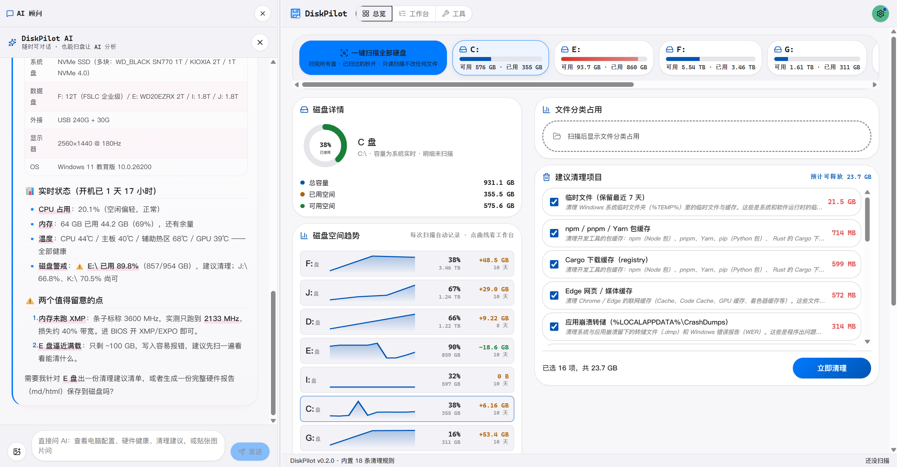
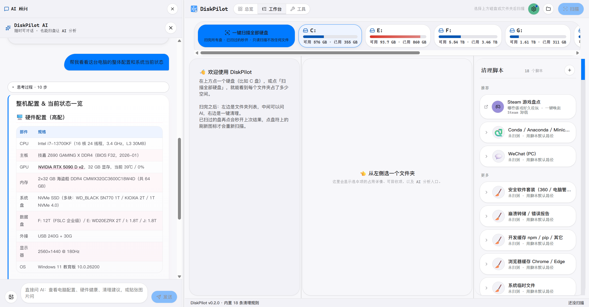
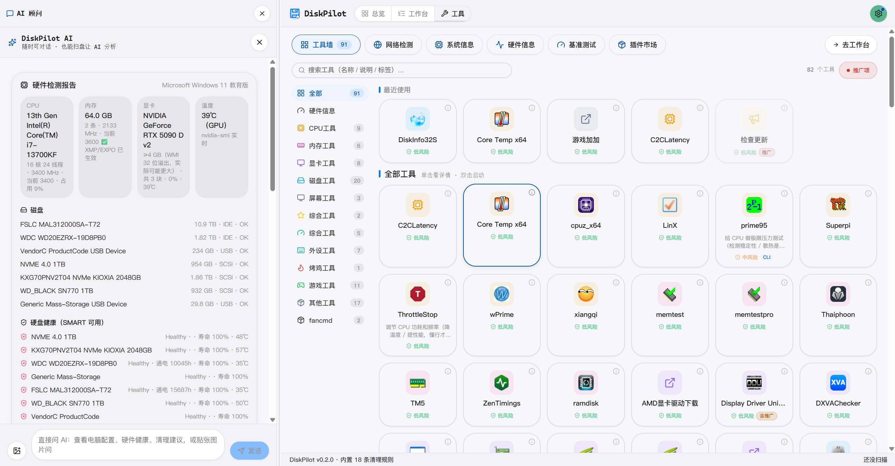

<div align="center">


# DiskPilot

**See your disk · Ask the AI · Clean safely — or let the AI operate it for you.**

Open-source disk analyzer and system inspector, built with Tauri 2 + Rust. Scan a whole drive in seconds to see where the bytes went, drag any unfamiliar folder to the AI for an explanation, clean known apps scope-by-scope via cleanup scripts; 76 built-in MCP tools let an AI agent plug in and run system checkups directly.

[](LICENSE)
[](https://tauri.app)
[](https://github.com/lxfebd/diskpilot/releases/tag/v0.2.4)

[Download](#download) · [Demo](#demo) · [Features](#features) · [Security model](#security-model) · [Privacy](#privacy) · [Architecture](#architecture) · [Docs](#docs) · [Roadmap](#roadmap) · [Development](#development) · [Contributing](#contributing)

**[简体中文](README.md) | English**

**Author: [@lxfebd](https://github.com/lxfebd) · [github.com/lxfebd/diskpilot](https://github.com/lxfebd/diskpilot)**

</div>

---

## Download

Current version **v0.2.4**, download directly from [GitHub Releases](https://github.com/lxfebd/diskpilot/releases):

| Platform | Installer | Notes |
|---|---|---|
| Windows 10/11 x64 | `DiskPilot_0.2.4_x64-setup.exe` | NTFS MFT direct read needs admin; the app auto-elevates via UAC |
| macOS (Apple Silicon / Intel) | `DiskPilot_0.2.4_aarch64.dmg` / `_x64.dmg` | **Unsigned / not notarized** — first open: right-click → Open; not yet validated on real hardware |
| Linux | `.deb` / `.rpm` / `.AppImage` | CI artifacts, **not yet validated on real Linux machines** — feedback welcome |

Every installer ships with a `.sig` signature; built-in auto-updater (tauri-plugin-updater) prompts in-app when a new version is out.

## Changelog

- **v0.2.4 (2026-11-02)**
  - **Community cleanup-scaffold loop**: one-click refresh of the official community index + install, end-to-end Ed25519 signature + sha256 + red-line validation; author side `scaffold-lint sign` to publish signed
  - **Keyboard accessibility专项**: game inventory / tool wall / treemap fully keyboard-operable; `?` opens the global shortcut panel
  - New `observations_overview` read-only MCP tool; health weekly report with trends and anomaly alerts
  - Engineering: three CI root-cause fixes, `cargo audit` clean, routine dependency updates
  - See [v0.2.4 release notes](docs/releases/v0.2.4.md)

- **v0.2.3 (2026-10-07)**
  - **AI "facts-only" constraint**: system prompt forces "tool output is the only source of truth, anything not in the list is treated as non-existent, guesses must be labeled" — eliminates AI hallucinating paths / filenames
  - **Path guard read/write dual policy**: read-only tools may enumerate drive roots (`list_dir C:\` is a necessary entry for whole-disk analysis); write operations still refuse drive roots / system dirs / user home roots
  - **Session resume**: interrupted scan overviews persist as `needsResume`; next scan of the same drive auto-resumes into the original bubble

- **v0.2.2 (2026-09-26)**
  - Shell 2.0: sidebar redesign / six cleanup-page components / optimize page (startup items + power plans) / operation history / preflight checks
  - 76 MCP tools for AI agents (65 read-only + 11 write, write tools gated by confirmation) + generic MCP server support
  - Tool wall with 90+ system tools + plugin market (Ed25519 verification + URL/registry install + update rollback)
  - Hardware center: benchmarks / stress tests / full sensor snapshots / trends & alerts / health report; fan write control (self-developed SuperIO direct read)
  - Scan & render performance专项, scan results persisted to disk, low-end machine tuning
  - Cleanup scaffolds expanded to 18 (QQ / Discord / game engines / Teams / Zoom / security suites …)

Build from source (~10–15 min):

```bash
git clone https://github.com/lxfebd/diskpilot diskpilot
cd diskpilot
pnpm install
pnpm tauri dev        # dev mode (first Rust compile 5–15 min)
pnpm tauri build      # produce installers
```

Requires **Node 20+ · pnpm 9+ · Rust stable**; on Windows also VS Build Tools 2022 + WebView2.

---

## Demo

<p align="center">
  
</p>

<p align="center"><sub>Overview · Left: AI advisor (ask "full machine config and current status", it answers with hardware table + temps + disk alerts) · Center: disk details + per-drive space trend curves · Right: suggested cleanups (16 items ticked, 23.7 GB, one-click clean)</sub></p>

<p align="center">
  
</p>

<p align="center"><sub>Workspace · Top: drive cards (one-click scan all drives) · Left: folder tree · Center: drag a folder into the AI to analyze · Right: Studio with 21 detected cleanup scripts (Steam inventory, Conda, WeChat, security suites …)</sub></p>

<p align="center">
  
</p>

<p align="center"><sub>Tool wall · 12 categories (CPU / RAM / GPU / disk / stress / games / peripherals …) with 90+ tools; single-click details, double-click to launch, each with a risk-level badge; left rail shows the live hardware report (SMART health, temps, sensors)</sub></p>

---

## Features

### 1. Second-level whole-disk scan

Direct read of the Windows NTFS Master File Table (with USN journal incremental updates); cross-platform `jwalk` fallback elsewhere. A full C: drive typically scans in 2–5 seconds. Results render as a colored treemap plus a compact single-line 22px-row tree view, every directory with a usage % bar. The home "Overview" adds a disk-card wall, per-drive space trend curves and per-category aggregation.

### 2. Drag any folder to the AI: "what is this"

Unfamiliar folder? Drag it from the tree into the central chat and the AI tells you what it is, whether it's safe to delete, and what you'd lose. The AI advisor also answers whole-machine questions (config, temps, disk health, cleanup suggestions). BYOK — bring your own Anthropic / OpenAI / Gemini key, or run Ollama locally for free. Chinese/English UI, light/dark themes.

### 3. Twenty-one cleanup scaffolds, cleaned scope-by-scope

For mainstream apps that eat real disk and have a clear cleanup boundary, we ship a **cleanup scaffold** (TOML-declared scopes + a Rust safety integration test); the Studio card cleans each scope individually. **Currently shipping twenty-one**:

| Scaffold | Scopes | What it cleans |
|---|---|---|
| **WeChat for PC** | 23 | 3.x + 4.x dual support — caches, received media, chat backups. Never touches chat DBs, favorites, Moments, or `CustomEmotion`. |
| **Conda environments** | 3 | Recycles stale envs as whole directories (`conda-meta/history` mtime > 90 days). Base env permanently grayed out. |
| **Browser cache** | 4 | Chrome / Edge cache + ServiceWorker cache |
| **Dev caches** | 5 | npm / yarn / pip / cargo caches |
| **Firefox cache** | 3 | Network / startup / shader cache |
| **Steam shader cache** | 1 | ShaderCache precompiled shaders |
| **Crash dumps** | 3 | User-level crash dumps + WER reports + system-level crash dumps |
| **System temp** | 1 | `%TEMP%` |
| **Docker Buildx** | 2 | BuildKit build cache + instance metadata; never images / containers / volumes |
| **HuggingFace cache** | 3 | Model hub / datasets / Spaces — auto-rebuilt after deletion |
| **OBS** | 2 | Crash dumps + logs; never touches recordings |
| **IDE caches** | 4 | VSCode / Cursor cache logs + IntelliJ caches/index |
| **QQ (PC)** | 5 | 9.x cache / images / files; never touches `nt_data` |
| **Discord** | 5 | Electron cache / GPUCache / Code Cache; login state and credentials are red-lined |
| **Game engine caches** | 7 | Unity / UE / Godot engine-level caches; never project `Library` / `.uproject` / `.godot` |
| **Microsoft Teams** | 11 | Classic 1.x + new 2.x; MSIX packages listed by directory name only |
| **Zoom** | 6 | Recording cache / WebRTC media cache allowlist |
| **Security suites** | 2 | 360 / PC Manager / Huorong caches; never the quarantine area or the binaries themselves |
| **Browser traces** | 2 | Chrome / Edge history DBs + Firefox form history; bookmarks, passwords, cookies, site data are red-lined |
| **Windows activity traces** | 3 | Recent items (incl. JumpList), thumbnail cache, INetCache; credentials and the thumbnail index are red-lined |
| **Windows update cache** | 2 | SoftwareDistribution/Download + Delivery Optimization cache; never the update history DB (`DataStore.edb`) or rollback dependencies |

Every scaffold goes through the same pipeline: on-machine directory survey → precise globs → `scaffold-lint` red-line check (CI-enforced) → safety test (positive + red-line reverse assertions) → real-machine dry-run. Better fewer than sorry — 36 unverified legacy template scaffolds were once delisted because unverified glob boundaries carry real mis-deletion risk.

### 4. AI agents can operate: 76 MCP tools (65 read-only + 11 write)

A standalone `agent-server` crate exposes itself over **MCP (Model Context Protocol) stdio** to any AI agent:

- **65 read-only**: disk health / SMART / big files / duplicate files, processes / services / drivers / startup items, CPU / GPU / RAM / motherboard / temps / full sensor snapshots, battery, network connections / NIC details / WiFi (never reads passwords), event logs / firewall / login audit / Defender status, Recycle Bin usage / environment variables / software inventory & Office activation, blue-screen dump analysis, Steam game library inventory & cleanup suggestions (suggestions only, never deletes)
- **11 write**: kill process / control service / recycle file / uninstall software / stress test / fan self-heal etc. — each one must pass the in-app UI two-step confirmation; an AI cannot bypass the confirmation gate to change system state

The path guard is derived from environment variables and refuses drive roots / system directories / home roots. The desktop tool wall has a dedicated "AI-operable" section; every tool has a detail dialog and a read-only/writable badge.

### 5. Hardware center (AIDA64-class capability)

CPU / RAM / disk / GPU benchmarks, CPU / GPU stress tests (temperature-fuse guarded), full sensor snapshots (temps, fans, voltages, power, clocks, load), sensor trends & alerts, DRAM timings / CPUID feature flags / display info, memory test, system health report.

### 6. Tool wall: 90+ system tools in one place

12 categories — CPU / RAM / GPU / disk / display / peripherals / stress / games … — CLI allowlist execution + one-click GUI launch, each tool with a risk-level badge, backed by a four-level permission model (the most dangerous level is permanently forbidden).

### 7. Plugin market: built-in tools can be pluginized, community registry extends online

CLI tools in the tool wall can be "pluginized" in one click (writes `tool.plugin.json`, removable anytime) — the same security model keeps applying. The plugin market pulls the **official index** `lxfebd/diskpilot-plugin-index` by default (live, 5 read-only diagnostic plugins: bigfile-finder / dup-finder / startup-audit / temp-hunter / log-hunter); a custom community index URL can be configured: envelope Ed25519 signature enforced, download sha256 enforced, in-package Ed25519 signature + signer anchored to the index entry, zip entries protected against traversal / zip bombs — one-click download / update / rollback / uninstall (uninstall goes to the Recycle Bin, recoverable).

---

## Security model

Deleting the wrong file is far worse than leaving 100 GB unreclaimed. Every delete path in DiskPilot sits behind layered gates:

1. **System Recycle Bin by default** — nothing is wiped directly; recoverable
2. **Operation log**: every deletion appends to `~/.diskpilot/undo.jsonl`; the "Recent cleanups" panel restores in one click (Recycle Bin / quarantine are the two recovery paths); optional 7-day quarantine mode
3. **Scaffold red lines**: `scaffold-lint` CI-enforces that no TOML glob hits user-data directories; every scaffold's safety test contains **red-line reverse assertions** (e.g. the WeChat scaffold must assert chat DBs are never matched); no test, no merge
4. **Write-operation confirmation gate**: the 11 MCP write tools require a confirmation parameter at the protocol level; the desktop UI confirms in two steps before dispatch; in agent mode the AI cannot cross this gate either
5. **Path guard (read/write dual policy)**: write operations refuse "delete it and it's over" paths — drive roots, system directories, user home roots, UNC network shares; **read-only tools may enumerate drive roots** (`list_dir C:\` is a necessary entry for whole-disk analysis), while system dirs / home roots stay refused even read-only. The guard derives from environment variables and shares the same `red_line_violations` anchor space as the runtime
6. **Backend defense-in-depth re-checks (R505)**: all write commands (execute cleanup / undo / install & uninstall scaffolds and plugins) require `confirmed=true` plus the matching permission toggle at the backend, independent of the frontend dialog — a compromised webview cannot bypass them; execution re-runs the red-line check on the scaffold; all outbound network requests (AI proxy / plugin index / MCP HTTP endpoints) pass an SSRF gate (private IP literals + DNS re-resolution must resolve to public addresses only)

The principle in one sentence: **rather mis-release 1000 GB than mis-delete a single file.**

---

## Privacy

- What goes to the AI is only **directory metadata**: path names, sizes, file counts, extension distribution, up to 20 sample paths — **file contents are never read**
- BYOK: your API key stays on your machine; requests go directly from your machine to the model provider
- Scan data, cleanup history, undo logs all stay local in `~/.diskpilot/` — nothing is uploaded to any cloud
- Directory enumeration uses listings only; chat databases, media files and credential files are never read

---

## Architecture

```
┌────────────────────┐     ┌─────────────────────┐
│   React + Tauri    │────>│  Rust workspace     │
│   (frontend UI)    │<────│  (7 crates)         │
└────────────────────┘     └──────────┬──────────┘
                                      │
   ┌───────────┬───────────┬──────────────────────┬───────────┬────────────┬───────────┐
   │           │           │          │            │           │            │           │
┌──▼─────┐ ┌───▼─────┐ ┌──▼─────┐ ┌──▼──────┐ ┌───▼───────┐ ┌─▼────────┐ ┌─▼──────────┐
│scanner │ │scaffold │ │executor│ │scaffold-│ │steam-     │ │toolbelt  │ │agent-server│
│NTFS MFT│ │TOML load│ │Recycle/│ │lint CI  │ │insp.      │ │tool wall │ │76 MCP     │
│+USN+walk││+globset │ │Quarant.│ │red-line │ │Steam inv. │ │90+ tools │ │tools(65+11)│
└────────┘ └─────────┘ └────────┘ └─────────┘ └───────────┘ └──────────┘ └────────────┘
```

| Layer | Stack |
|---|---|
| Frontend | React 18 + TypeScript + Tauri 2 · Zustand · i18n (EN/ZH) · light/dark themes |
| Backend | Rust workspace (7 crates) + Tauri IPC |
| Scanner | Windows: NTFS MFT direct read + USN journal incremental / cross-platform: `jwalk` |
| AI | BYOK · Anthropic / OpenAI / Gemini / Ollama (4 protocols) |
| Agent interface | MCP stdio (`agent-server` standalone process, attachable by any external agent) |
| Data | Local `~/.diskpilot/` (undo.jsonl + quarantine/) · never uploaded |

---

## Docs

- [docs/](docs/README.md) — architecture deep-dive, user guide, scaffold authoring guide
- [docs/mcp-tools.md](docs/mcp-tools.md) — reference for the 76 built-in MCP tools (params & security tiers)
- [docs/plugin-market-index.md](docs/plugin-market-index.md) — plugin market community index contract (for standing up the official index repo)
- [docs/publish-plugin-guide.md](docs/publish-plugin-guide.md) — publishing a plugin to the community market (author quickstart)
- [docs/security-model.md](docs/security-model.md) — threat model + per-layer defense code map (incl. R505 hardening)
- [website/index.html](website/index.html) — project promo page (open directly in a local browser)

---

## Roadmap

Done:

- [x] Second-level whole-disk scan + treemap / tree view + overview page (disk cards / space trends / category usage)
- [x] Drag folders to the AI + whole-machine AI advisor (BYOK, 4 protocols)
- [x] 21 cleanup scaffolds + red-line validation + safety test pipeline
- [x] Recycle Bin / undo.jsonl / quarantine / one-click undo
- [x] 76 MCP tools agent layer (write tools behind confirmation gate)
- [x] Hardware center (benchmarks / stress / sensors / health report) + tool wall with 90+ tools
- [x] Steam game library read-only inventory + shader cache cleanup
- [x] Performance专项： scan-chain memory & render tuning (clone pruning / selection node refs / virtualized lists / batched detect / blacklist dirs)
- [x] Scan results persisted to disk (survive restarts, recent drives reopen instantly)
- [x] Low-end machine tuning (tiered overscan / poll-frequency downscaling)
- [x] v0.2.2 release pipeline: CI build + signing + in-app auto-update
- [x] Overview "category usage + reclaimable potential" redesign + daily checkup banner (health butler P0: red drives / reclaimable / temps / startup digest)
- [x] Plugin market loop: official/community index (Ed25519 enforced) + URL/registry install + update rollback + installed ledger
- [x] Shell 2.0: sidebar redesign / six cleanup-page components / optimize page (startup + power plans) / operation history / preflight checks
- [x] AI facts-only constraint + guard allows read-only drive-root listing: CHAT_SYSTEM forces "tool output is the only source of truth, anything not listed is non-existent, guesses must be labeled"
- [x] Session resume: interrupted scan overviews persist as `needsResume`, auto-resumed on next scan of the same drive
- [x] Cross-scan cleanup comparison (health butler P0): root totals + per-scaffold snapshots recorded at scan time
- [x] User-authored scaffold loop: scaffold CLI (new/lint) + safety-test CI hard gate + community sharing channel (remote refresh of the official index / author `sign` to publish; installer enforces Ed25519 + red lines)
- [x] Official plugin index repo live (`lxfebd/diskpilot-plugin-index`) with 3 signed read-only diagnostic plugins; client defaults to it

In progress / planned:

- [ ] Linux real-hardware validation (macOS intentionally unsigned/notarized, left to community builds)

---

## Development

```bash
git clone https://github.com/lxfebd/diskpilot diskpilot
cd diskpilot
pnpm install
pnpm tauri dev            # desktop app (first Rust dependency build 5–15 min)
pnpm -C apps/desktop dev  # frontend only, browser debugging
cargo test --workspace    # full Rust workspace tests (on Windows, MFT-related cases need an admin terminal;
                          # under Git Bash TEMP=/tmp pollutes native binaries' temp dirs and causes false failures — use native cmd/PowerShell)
pnpm -C apps/desktop exec vitest run   # frontend tests
```

Layout at a glance: `apps/desktop` (Tauri frontend + backend), `crates/` (7 Rust crates), `scaffolds/` (21 cleanup scaffold TOMLs).

> After changing guard / tool logic in `crates/agent-server`, you must `cargo build -p agent-server` to rebuild `target/debug|release/agent-server.exe` — the frontend agent.rs tests spawn that artifact, so source edits without a rebuild still run the old guard.

### Authoring your own cleanup scaffold (scaffold CLI)

Want "this app, one-click cleanup" too? Draft with the interactive generator; the same red-line validation gates it on the spot:

```bash
cargo run -p diskpilot-scaffold --bin diskpilot-scaffold-gen   # Q&A → generates scaffolds/<id>.toml
                                                               #   + crates/scaffold/tests/<id>_safety.rs skeleton
cargo run -p diskpilot-scaffold-lint -- scaffolds/<id>.toml   # static check (passes only with zero red-line hits)
cargo test -p diskpilot-scaffold --test <id>_safety           # fill in positive / red-line assertions, then run
```

The generator reuses the same `red_line_violations` list as CI and the runtime — any hit is a hard error; tighten the glob, don't widen the list.

## Contributing

The most valuable contribution is **writing a cleanup scaffold for a new app**. Each scaffold requires:

1. Survey the app's real directory structure on a real machine; find the cache-vs-user-data boundary
2. Write the TOML following [`scaffolds/_templates/`](scaffolds/_templates/)
3. Write the safety test following [`crates/scaffold/tests/_templates/`](crates/scaffold/tests/_templates/) — **positive assertions + red-line reverse assertions**, CI runs it, no test no merge
4. Verify with a local dry run before opening the PR

Other directions are welcome too: fixing scan/performance issues, translations, validating on real Linux/macOS machines and reporting issues.

---

## Acknowledgments

- **Inspiration**: [WizTree](https://diskanalyzer.com) (NTFS MFT direct read), [SpaceSniffer](http://www.uderzo.it/main_products/space_sniffer/) (treemap visualization), [CleanMyWechat](https://github.com/blackboxo/CleanMyWechat) (WeChat cleanup boundaries), [SquirrelDisk](https://github.com/adileo/squirreldisk) (Tauri + Rust form factor)
- **Dependencies**: [Tauri](https://tauri.app) · [`d3-hierarchy`](https://github.com/d3/d3-hierarchy) · [`jwalk`](https://github.com/jessegrosjean/jwalk) · [`ntfs`](https://github.com/ColinFinck/ntfs) · [`globset`](https://github.com/BurntSushi/ripgrep/tree/master/crates/globset) · [`trash-rs`](https://github.com/Byron/trash-rs) · [react-markdown](https://github.com/remarkjs/react-markdown) · [rmcp](https://github.com/modelcontextprotocol/rust-sdk)

---

## License

[MIT](LICENSE) · fork, commercial use, and closed-source derivatives welcome. When you modify cleanup scaffolds, please maintain their safety tests too — the red-line assertions are the last gate against deleting user data.
